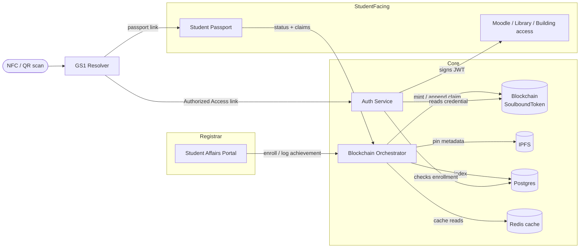

# CampusPass — local MVP

A campus identity system: one non-transferable blockchain credential per student, used for
passwordless login (Moodle, library, building access) and as a living, verifiable record of
achievements (certifications, volunteer hours) that follows the student rather than living in
five different school systems.

This is a reframing of an earlier "Ethical Digital Product Passport" concept (see
[`docs-source-HLD.md`](./docs-source-HLD.md) for that original spec) — same machinery, aimed at
students instead of products, and still fully capable of the original product use cases (see the
smoke test below, which exercises both). See [`DECISIONS.md`](./DECISIONS.md) for why the pivot
kept the underlying GTIN/serial-shaped identifier pair, and for a full account of a 2026-09-02
compliance audit against the original HLD — including three real bugs found in the vendored GS1
Resolver, and what's fixed vs. still an open finding (GDPR, JSON-LD vocabulary purity).

  

  <i>Narrated explainer — see <a href="./video/README.md"><code>video/README.md</code></a> to rebuild it from source
  (entirely local generation: procedural PIL animation + Kokoro-82M TTS, no stock footage).</i>

Everything runs **locally** right now (local blockchain node, local IPFS node, local
Postgres/Redis) — nothing is deployed. The stack is chosen so it can scale later without a rewrite.

## Architecture

