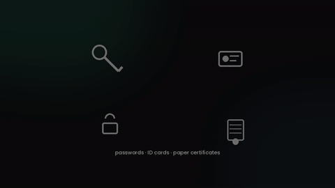
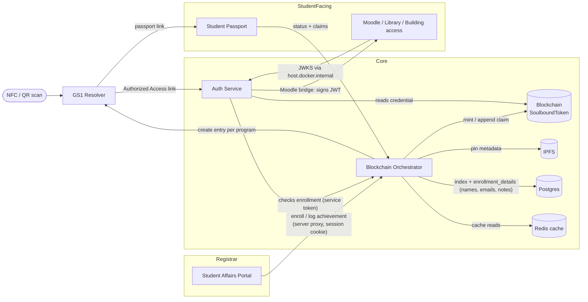

# CampusPass — local MVP

A campus identity system: one non-transferable blockchain credential per student, used for
passwordless login (Moodle, library, building access) and as a living, verifiable record of
achievements (certifications, volunteer hours) that follows the student rather than living in
five different school systems.

This is a reframing of an earlier "Ethical Digital Product Passport" concept (see
[`docs-source-HLD.md`](./docs-source-HLD.md) for that original spec) — same machinery, aimed at
students instead of products, and still fully capable of the original product use cases (see the
smoke test below, which exercises both). See [`DECISIONS.md`](./DECISIONS.md) for why the pivot
kept the underlying GTIN/serial-shaped identifier pair, and for a full account of a 2026-09-02
compliance audit against the original HLD — including three real bugs found in the vendored GS1
Resolver, and what's fixed vs. still an open finding. The two findings left open by that audit
(GDPR, JSON-LD vocabulary purity) have since been resolved — see the newer `DECISIONS.md` entries.

<p align="center">
  
</p>

<p align="center">
  <i>Narrated explainer — see <a href="./video/README.md"><code>video/README.md</code></a> to rebuild it from source
  (entirely local generation: procedural PIL animation + Kokoro-82M TTS, no stock footage).</i>
</p>

Everything runs **locally** right now (local blockchain node, local IPFS node, local
Postgres/Redis) — nothing is deployed. The stack is chosen so it can scale later without a rewrite.

## Architecture



## Running it

From the repo root, with each service's `.env` copied from its `.env.example`
(`ORCHESTRATOR_API_TOKEN` must be identical in the orchestrator, auth-service and portal;
set `PORTAL_SESSION_SECRET` in the portal with `openssl rand -hex 32`):

```bash
docker compose up -d                                   # postgres, redis, ipfs
pnpm --filter @campus-pass/contracts node &            # local chain on 127.0.0.1:8545
pnpm --filter @campus-pass/contracts deploy:local      # copy the address into SBT_CONTRACT_ADDRESS
(cd services/resolver && docker compose up -d --build) # GS1 Resolver on :8090
pnpm --filter @campus-pass/shared build
pnpm --filter @campus-pass/blockchain-orchestrator create-registrar registrar '<password, 12+ chars>'
pnpm dev                                               # passport 3000, portal 3002, auth 4001, orchestrator 4002
pnpm --filter @campus-pass/blockchain-orchestrator backfill
```

- Registrars sign in to the portal (`localhost:3002`) with an account made by `create-registrar`
  (rerunning it resets the password). The portal's server proxies every orchestrator call;
  the service token never reaches the browser.
- `backfill` syncs chain history into Postgres and (re)creates the GS1 Resolver entry of every
  program, replacing the old hand-run resolver loader script. Programs added in the portal get
  their entry automatically.
- `bash ops/moodle/setup.sh` starts Moodle on `localhost:8092` and wires `auth_jwtsso` to the
  Auth Service's JWKS, fetched from inside the container through `host.docker.internal`.
  If the host firewall blocks bridge-to-host traffic to :4001, the script stops with the curl
  exit code; allow it, or run `KEY_SOURCE=pem bash ops/moodle/setup.sh` to pin the public key
  instead (no automatic key rotation).
- `REGISTRAR_USERNAME=registrar REGISTRAR_PASSWORD=... bash ops/moodle/e2e-check.sh` enrolls a
  fresh student and walks resolver -> Auth Service -> Moodle, then the replay and revoke cases.
  It prints `PASS` on success and leaves the created student in place.
